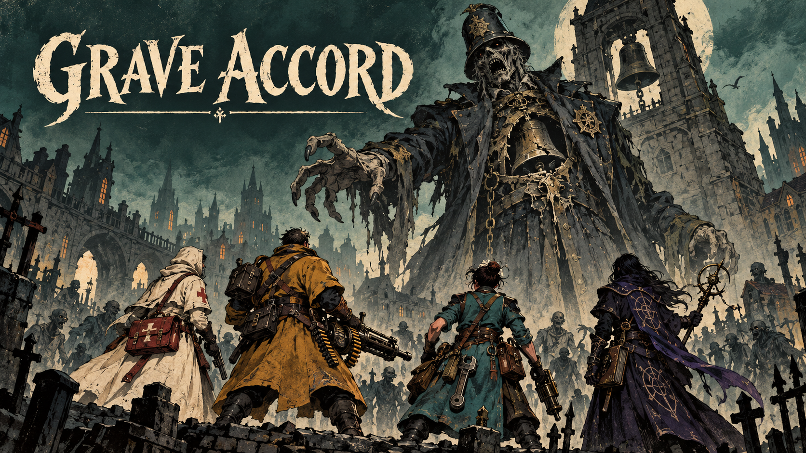

# Grave Accord

An original cooperative zombie bullet hell about survivors keeping a forgotten city alive. Dry ink, matte gouache, distinct class roles, shared mutation votes and escalating civic horrors.

**Current status: Stage 1 preproduction. A playable game has not been released yet.** The complete implementation is authorized and tracked in the [production Project](https://github.com/users/ProgrammingWithYagle/projects/3). The [Wiki](https://github.com/ProgrammingWithYagle/Bullet-Hell-Game-Open-AI-Contest-/wiki) is initialized; its canonical guides are prepared in docs/wiki for publication.

The authored design includes seven classes with cooldown ultimates, 126 skills, 28 weapons, 24 mutations, six arena kits, fifty route bosses, nine Endless-exclusive bosses and one secret boss. Quarantine Run, Midnight Circuit and Black Bell Pilgrimage are distinct campaigns; Grand Raid supports sixteen players; Endless Vigil has no final round and targets fifty. Player counts and performance remain implementation gates until measured.

The Stage 1 source includes a full [production bible](docs/GAME_BIBLE.md), [sixty-boss gauntlets](docs/BOSS_ROSTER_EXPANSION.md), [balance tables](docs/balance), [leaderboard contract](docs/LEADERBOARDS.md), [audio bible](docs/AUDIO_BIBLE.md), [localization data](docs/LOCALIZATION_IMPLEMENTATION.md), eight original art proof sets, cleaner finish references and an editable original audio library. Fifteen AI-authored language catalogs contain 14,385 messages. Human playtesting, native-speaker review and physical-device performance remain separately recorded checks.

Open assets/proofs/animation/index.html to review animation proofs and assets/audio/preview.html to audition music and SFX. These worksheets work locally without a game server. They are preproduction reviews, not gameplay.

With Node 24, run npm run verify to validate the authored content, art/audio evidence and localization catalogs. The illustrated PDF and portable Stage 1 packet are produced by the tools in tools/; source, fresh extraction and ordinary Windows copy must agree before delivery.

The game implementation uses TypeScript, Phaser, Vite, Colyseus and Electron with one shared authoritative rules simulation. A free Render realtime service and a public browser client with durable global team records are the approved hosting design. No paid provisioning is authorized.

See [CHANGELOG.md](CHANGELOG.md) for implemented changes, [the acceptance backlog](docs/IMPLEMENTATION_BACKLOG.md) for planned work, and [THIRD_PARTY_NOTICES.md](THIRD_PARTY_NOTICES.md) for provenance and licenses. The original MIT license is preserved. Actual Handshake submission is tracked separately from source and release publication.
