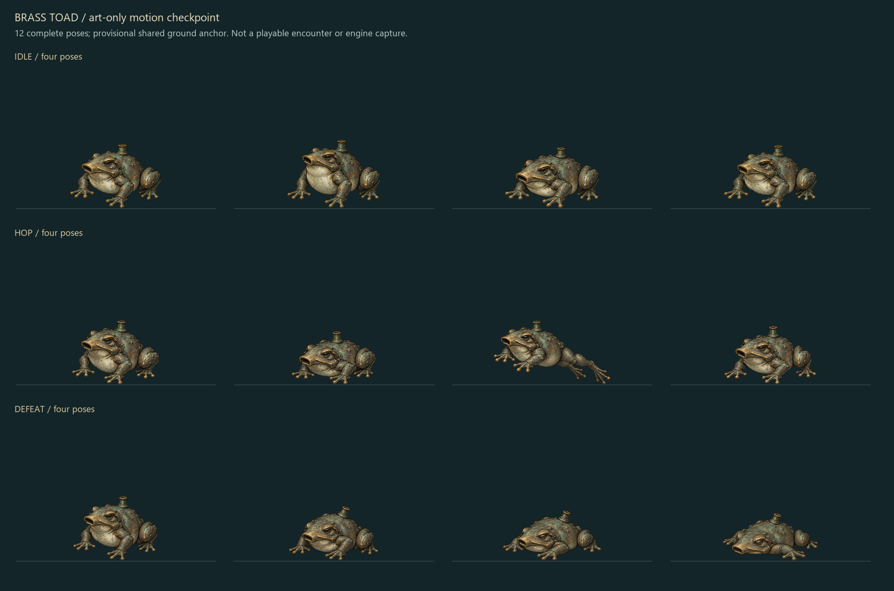

# Grave Accord continuation checkpoint — October 25, 2026

This is a requested handoff checkpoint, not a completed-game release. The user asked to finish the current work, save it locally and on GitHub, clean stale instructions and continue in a new chat. Resume only when the user starts that continuation. Use this file and the structured progress ledger before older subsystem records.

## Exact workspace and source

- Existing project: `C:\Users\yigal\OneDrive\Documents\ChatGPT\OpenAI Multiplayer Game Contest (Bullet Hell)`.
- Repository: [ProgrammingWithYagle/Bullet-Hell-Game-Open-AI-Contest-](https://github.com/ProgrammingWithYagle/Bullet-Hell-Game-Open-AI-Contest-).
- Branch: `feat/first-playable-loop`; [PR #14](https://github.com/ProgrammingWithYagle/Bullet-Hell-Game-Open-AI-Contest-/pull/14) stays draft.
- Last gameplay commit before this art/documentation checkpoint: `f1766fe9c41184df44c15902533aff0e2fd7ef2c`. Inspect actual `git status --short`, HEAD and origin before editing; this document is committed with the successor checkpoint.
- Build: `2026.10.25-brutal-signals`; protocol **14**; content revision `43b7b2848b50bbe56072bfa134e5775355a7faca28092624744bdae6a0d318bb`.
- Protected main stays `c3f60ca4125bea31d94c9d3f6ea0c9d3f0853df1`. No merge, paid provisioning, contest submission or replacement Site is authorized by this handoff.

## Current implementation and remaining scope

The playable source has **60 bosses: 59 ordinary and one secret**, seven classes, 378 skills/63 specialization paths, 28 weapons, eight supplies, 24 mutations, six maps and five modes. Each of the sixty bosses has an original theme; City Wake is the additional ambient track. All seven basic survivor motion sets are drawn. There are **1,466 selected runtime motion poses** across the complete installed scope; the twelve new Toad candidates below are separate.

| Requested pass | Implemented | Remaining | Acceptance |
| --- | --- | --- | --- |
| Ordinary bosses, three per fifty subtiers | 59 / 150 | **91 new identities** | New art concepts do not count |
| Existing-boss phase/mobility/Brutal quality | 1 / 60 | **59 assessments/redesigns** | Latest Constable pass awaits human review |
| Ability-changing class-upgrade revamps | 0 / 7 | **7** | Existing seven kits and 378 skills are playable |
| Optional large branching skill-tree view | 0 / 1 | **1** | Preserve the classic view and add a settings toggle |
| Secondary-map topology revamps | 5 / 5 | **0 implementation** | Five detailed human layout reviews remain open |
| Ground-art deliveries | 6 / 6 | **0 installation** | Limited Normal/Constable readability feedback only |
| Early Watch art-only motion candidate sets | 1 / 3 | **2** | Toad technical review only; no engine/human acceptance |

[Development progress](DEVELOPMENT_PROGRESS.md) and `docs/development-work-ledger.json` are the count authority. `tools/sync-development-progress.mjs` generates the local page, canonical Wiki page and shared in-game JSON. Update the ledger at meaningful checkpoints; run `--check` before publication. `src/shared/update-history.json` similarly drives the journal and both changelogs through `tools/sync-changelog.mjs`.

## Latest feedback and completed response

The human tested the earlier frozen **5177** build. Constable was slightly harder but appropriately easy; phase changes and Brutal still felt too similar. Music could be a little more intense. This is feedback on the predecessor, not approval of the later pass.

The completed f1766fe response adds a Brutal Patrol pincer, Cordon ring follow-up, triple Lockdown rings and Curfew rings plus pincer. Normal Cordon moves laterally. Attacks lock warnings and preserve recovery; phase changes clear outgoing attacks. Four-second static phase-entry HUD edges and persistent response hints cover fifteen languages. Living Brutal main sprites have a warm red tint and broken red ground arcs; Normal/death clears them. Separate multipart actors have not all received an additional part-by-part treatment.

A quiet original synthesized tom/rim layer follows the existing sixty scores' BPM/meter, adds phase/Brutal accents and respects volume, warning ducking, visibility, voice bounds and stop cleanup. Original music bytes remain unchanged. Adopted policy: fixed boss identity and extra mechanics in the explicit Brutal form; global difficulty mainly scales stats, projectile pressure and resources while retaining recognizable tells. [Exact implementation](PHASE_AND_BRUTAL_FEEDBACK.md).

## Art checkpoint — resume here

Three original concepts are preserved: **Ashen Usher 1--**, **Brass Toad 1-**, **Ragpicker's Kite 1**. None is a playable encounter yet. The proposed mechanics are in `assets/production/generated/early-watch-motion-2026-10-25/design.issued.json`.

**Brass Toad:** four generated sheets are preserved. Hop v1 was rejected for insufficient padding/overlapping extents; actual clipping was not established. Hop v2, idle v2 and defeat v1 provide twelve complete technically normalized candidate poses. All alpha-bearing RGBA, connected figure ownership and final atlas packing are independently reconstructed. Uniform scale per native clip calibrates the initial upright body, then a shared readable bottom-center anchor retains faint surrounding pixels. Wider 768-pixel candidate cells are art-only and are not loaded by the game. Partial packing attempts remain in dated review history.

**Ashen Usher and Kite:** six full-sheet requests are prepared but have never been executed. A separate old Toad idle request was superseded before execution. The eleven prepared request files therefore include only four actual executions. Exact issued bytes and absolute paths are immutable; the provenance file provides repository-relative bindings. Start a new versioned request when adapting paths or layout, and view local references before image editing.

- [Motion provenance and portable bindings](early-watch-motion-checkpoint-2026-10-25.json).
- `assets/production/generated/early-watch-motion-2026-10-25/`: four natives, eleven requests, nine prepared reference canvases/seeds, issued preparation records and normalized candidates.
- `reviews/early-watch-motion-2026-10-25/`: original helpers, all partial packing history, independent verification and current full-suite evidence.
- `python -X utf8 tools/verify-early-watch-checkpoint.py`: Pillow/NumPy whole-pose and source/atlas reconstruction. It does not certify timing, root lift, browser rendering or gameplay.
- The three concept natives/requests remain under `assets/production/generated/early-watch-concepts-2026-10-25/` with their existing provenance.

Next: finish Usher/Kite whole-sheet motion with stable scale and complete poses, then implement three distinct shared-authority encounters with obvious phases, movement/arena pressure, warned counterplay and additional Brutal behavior. Add individual original themes, all fifteen locale names/help, canonical ratings and real tests. Only then increase the roster to **63**, ordinary to **62** and reduce the deficit to **88**. Continue other encounter quality, ability-changing upgrades and the optional tree afterwards.

Integration checklist: `BossId`/implemented IDs, content source and generated catalog/revision, fixed threat profiles, shared directors/cues/weak points, schema/session/view, client art/pose metadata, offline Practice migration bounded to issued revisions, route/Endless reachability, score/MP3 delivery, localization, progress/changelog and Wiki. Generic defeat assumes eight frames in some paths: the new four-frame candidate must have explicit range/timing metadata. Preserve the old loading-v3 reference bytes when creating a successor delivery version. Wind must share bounded force logic between authority and prediction. Do not count a recolor or stronger form as a new identity.

## Preview and verification

Latest preserved manual preview: **http://127.0.0.1:5178/**, frozen at f1766fe, build `2026.10.25-brutal-signals`, protocol 14. Its 1,651 copied files/656,484,789 bytes match production byte-for-byte; seventeen HTTP checks passed. This art/journal checkpoint does not replace that frozen runtime. The latest art progress is visible in the saved contact and updated source journal, not as a new in-game boss in that preview.

Compare New Run → Soldier → Quarantine Run → Gatehouse → Normal difficulty → review Hollow Constable, Solo, Boss form **Standard form** or **Brutal** → Play. Any class/map is valid; keep choices equal for comparison. No human verdict on f1766fe is recorded yet.

Current preview PID **71580** (restarted after the former 34336 process ended), root `C:\Users\yigal\Documents\Codex\2026-10-23\can-you-continue-with-the-development\work\playtest-brutal-signals-f1766fe`. Preserve older frozen ports 5174–5177 too. PIDs are historical identifiers: verify command line and occupancy before stopping any process. Mutable dev 5173 and server 2567 may not share the current protocol; never restart occupied rooms casually.

The predecessor's **382 tests**, content/fifteen locales, TypeScript and production build passed locally; both exact-head GitHub checks passed. Its source snapshot was `30b61b5240015871a61551286acf4dc5e1465784abecca5fb3c1e4d1a5014a1b`. The successor checkpoint's current full-suite evidence is saved as `reviews/early-watch-motion-2026-10-25/runtime.json` and `full-current.log`; check those exact source/artifact hashes. The final publication receipt is also saved in the previous chat's outputs directory.

Browser control is disabled in Work settings. The human explicitly asked to stop troubleshooting it. Do not retry, bypass with CDP or substitute browser-like evidence for actual rendered review. Continue source/headless/HTTP/art work and keep browser/device/audio/native-language gates open.

## Publication and remaining release work

Canonical Wiki: `docs/wiki/`; native checkout: `.wiki-checkout`; public [Development Progress](https://github.com/ProgrammingWithYagle/Bullet-Hell-Game-Open-AI-Contest-/wiki/Development-Progress). This checkpoint has **18 pages and 27 images**. Publish from a concrete committed source, verify remote Wiki is unchanged/clean, copy exact committed pages/images and run `node tools/verify-wiki-publication.mjs <source SHA>`. That verifies Git blobs, all public image hashes and four anonymous HTML responses, not rendered Wiki acceptance. A source PR push alone does not publish the Wiki.

The GitHub connector handles read metadata. Its PR-mutation access previously returned 403; the repository-scoped `node tools/github-admin.mjs update-pr` fallback uses configured credentials in process memory. Never print credentials. `checks <SHA>` reads exact checks. Keep PR draft and protected main unchanged.

The public Site remains the old protocol-4 two-class/one-boss build under another account. Do not create a replacement Site or pair a new backend with its old frontend. The issued [Windows development ZIP](https://github.com/ProgrammingWithYagle/Bullet-Hell-Game-Open-AI-Contest-/releases/tag/dev-windows-20261024-1) remains immutable, source `52552c0d4465b918d7cde2ab3c2aa7f1d7eb045e`, protocol 13. A new release needs a new tag/name and complete validation.

Remaining release gates include active mixed-progression 8/16/50-player, WAN and full progression endurance, 49 scripted plus one rendered under the target hostile load, physical controller/phone/native-language/listening and human balance. The one-hour local fifty-client probe is frozen-source continuous combat with zero rendered clients. Durable recovery still needs participant credentials, entropy history/paging, departures, hosted storage/owner acceptance and deployed rankings; the normal writer remains disabled. Profiles/cosmetics, short/standard/long/Raid/Endless and the individually consented bank-safe secret extension already exist. Do not reimplement them as if absent.

## Development setup and constraints

Use Node 24 and pnpm 11.25.0. `pnpm verify` performs content, type, real WebSocket/HTTP/SQL and production-build checks. Bundled Node is `C:\Users\yigal\.cache\codex-runtimes\codex-primary-runtime\dependencies\node\bin\node.exe`; fallback pnpm is in `dependencies\bin\fallback`. Include both directories in PATH. Python 3.11 has Pillow/NumPy; use `python -X utf8`. No SciPy/OpenCV is required by the shipped art verifier.

Read applicable AGENTS/skills, inspect actual Git status, preserve in-flight work. The repository is outside the previous task's writable root, so reviewed elevated shell access was used for writes, Git, local networking and builds. Use `git -c core.bare=false` consistently. No new clone, worktree, paid provider, main merge, contest submission, unsolicited external messaging or subagent delegation. Built-in image generation is the authorized art tool; technical whole-pose extraction/resizing may use Pillow. Never repaint anatomy or silently discard alpha to make an atlas fit.

Active documentation has been consolidated. Exact pre-cleanup handoffs/state/acceptance/roster plans are preserved under `docs/history/2026-10-25-checkpoint-cleanup/`; [cleanup inventory](checkpoint-cleanup-2026-10-25.json) records their hashes. Older subsystem guides are explicitly dated records, and older counts/formulas are superseded by current progress and fixed-threat rules. Issued assets, raw returns, failed evidence, prior builds and historical changelog entries remain available.
