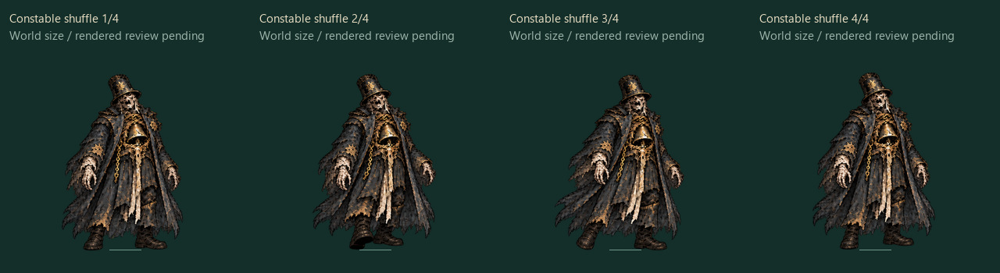

# Hollow Constable: patrol, cordon and lockdown

Build `2026.10.25-constable-patrol`, protocol 14. Hollow Constable remains **1+**, high tier Normal. Brutal is **1+ B**. This quality pass adds no boss identities: 59 ordinary bosses and one secret remain implemented; the three-per-subtier target still needs 91 additional ordinary identities.

| Phase | Movement between casts | Attack identity | Response |
| --- | --- | --- | --- |
| Patrol | Collision-resolved patrol, 56 units/second | Two aimed fans, 0.4 seconds apart | Move after aim locks; read both warned volleys |
| Cordon | Faster patrol/flanking, 76 units/second | Two flank origins fire crossing fans and then a second pair | Cross between the warned trajectories; leave the spaced stamp line |
| Lockdown | Pursuit with lateral weave, 96 units/second | Two staggered rings, 0.45 seconds apart, with overlapping open wedges | Follow the common wedge while leaving arrest stamps |
| Curfew, Brutal only | Pursuit, 108 units/second | Three staggered rings with a narrower shared wedge | Commit to the common escape sector and use the Accord window |

Normal transitions remain 75% and 40% health; Brutal uses 75%, 50% and 25%. Global difficulty, mutation and Endless factors still apply separately. The first Normal Patrol fan retains its 26-tick warning, eight bullets, 163.2 speed and 12.3 base damage; the additional second volley has its own visible warning from cast start. Cordon produces 36 projectiles across four Normal fans. Lockdown produces 46 across its two Normal rings. Curfew uses three stronger rings. These are actual shared-simulation emissions, not decorative particles.

Each cast locks all origins and aims at warning creation. Casts serialize, and the boss stays planted through the last delayed release plus 20 ticks of recovery. Patrol resumes with physical steps rather than relocation. Cover and arena bounds resolve every step. Accords, stagger and defeat stop movement. Ordinary hit reactions do not permanently stun-lock patrol; moving sprites keep their footwork while the health/damage state updates normally.

Arrest stamps use a spaced line with bounded count, clear outlines and shorter persistence. They do not tile the whole arena. Phase transitions clear outgoing hostile bullets, pending warnings, arrest fields and stale cast timing; the existing Accord opportunity and phase sound remain. Successful Accords clear pending attacks, heal active survivors and preserve the full four-second stagger/vulnerability window.

## Sprite production

The built-in image generation tool returned one complete four-pose strip. The inspected approved idle cell and exact request are preserved in `assets/production/generated/constable-pressure-2026-10-25/`; [provenance](constable-pressure-2026-10-25.json) binds their original arguments and SHA-256 values. All 27 original Constable poses, requests, natives and the issued library remain unchanged. A separate shuffle library extends the renderer and Art Room.

Packing uses one scale calibrated from upright frame zero, with the same body world height as idle. A 448-pixel cell preserves faint native edge pixels with safe padding; the first 384-pixel packing attempt was rejected by its gutter guard before writing an atlas. Every native RGBA pixel partitions exactly once, and independent reconstruction reproduces all four packed frames. The new atlas adds 3.0625 MiB of dimension-derived RGBA texture data. Existing boss-cache figures explicitly exclude Constable/Warden and other scene textures; this is no device-memory or FPS claim.

## Verification and limits

The full pipeline passes 367 automated tests, authored-content/fifteen-locale validation, TypeScript and the production client build. Eleven new regressions exercise real Normal/Brutal phase emissions; warnings and release counts; the common ring escape sector in emitted projectiles; real arrest damage and an escaped position; patrol collision and planted casts on all six maps; phase cleanup; 30 Hz positions at a 60 Hz drawing cadence; native/atlas reconstruction; and all fifteen phase-label sets. Exact evidence is in `reviews/constable-pressure-2026-10-25/`.

The native sheet and normalized world-size contact were inspected. Browser control remains unavailable. This stage does not establish rendered transition quality, physical-device performance, native-speaker translation acceptance or human difficulty balance. Other bosses still need qualitative phase/mobility review; ability-changing upgrades, the optional branching skill-tree view, new identities and final release work remain active.

Local Practice boundaries from the exact issued pre-patrol content revision (`b8d9fb69…`) migrate through existing validation, including protocol-13 map builds and protocol-14 fixed-grade builds. Coins, upgrades, personal progress, run identity and history remain intact. Current-version cards keep strict fixed-grade/risk validation; unknown revisions and online records are rejected. Independent art reconstruction runs separately and portable Node tests bind its sealed receipt to every exact input.
