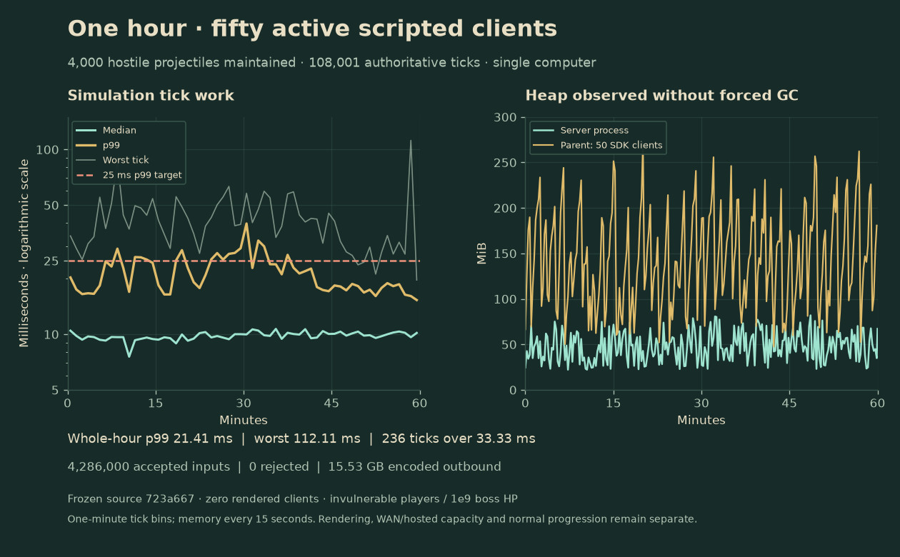

# One-hour fifty-client combat observation

One completed localhost run maintained fifty active scripted clients and 4,000 hostile projectiles for **3,600.15 seconds**. Across **108,001 ticks**, median simulation work was **9.83 ms**, p99 **21.41 ms** and worst **112.11 ms**. **236 ticks exceeded 33.33 ms**. The fixture passes its whole-hour p99 target below 25 ms; the slower ticks remain visible in the raw record and figure.

This measures continuous combat on one Intel Core 9 270H Windows computer using Node 24.22.1. The authority and fifty real Colyseus SDK clients use separate OS processes/heaps. The roster has eight Soldiers and seven of every other class. There are **zero rendered clients**. Players are protected, the single Choir of Moths boss has 1e9 HP/deadline, and the fixture replenishes hostile projectiles. It does not exercise authored fight balance, normal progression, votes/shop/deaths/reconnect, a rendered fifty-player scene, WAN or hosted capacity. Other normal art packing and build activity occurred on the same host.

The server accepted **4,286,000 inputs**, rejected **zero**, and encoded **15,534,440,747 outbound bytes** (15.53 decimal GB; approximately 4.32 MB/s aggregate). Although input timers request 30 Hz, the observed accepted average is approximately **23.81 inputs/s per client**. Sampled server heap ranges from approximately **22.19 to 81.99 MiB**; the SDK parent ranges from **47.60 to 271.59 MiB**. No forced GC is used. These are observed ranges and trends, not a universal memory bound or a claim that leaks are impossible.

The frozen source is `723a66796e4a6d2c6d3c28611b5b7a5366de2f08`, verified with 292 tests before freezing. Source files, tool/lockfile hashes and both executable bundles are preserved in `reviews/performance/endurance-20261024-2/`. The immutable raw measurement is `reviews/performance/endurance-50-moths-20261024-2.json`. `tools/verify-endurance.py` independently recomputes quantiles, time/count criteria, traffic, memory summaries and every frozen source/bundle hash against the committed source. Source artwork advanced during the frozen run; this report does not attribute its timings to the newer action build.

The production tick history remains at 18,000 entries. The fixture copies newly observed deltas without clearing or expanding that ring and rejects a missed observation. Memory and traffic samples occur every fifteen seconds. The figure uses one-minute timing bins and includes each minute's worst tick; the raw report retains every timing. Matplotlib produces the figure, with exact tool and input hashes. Figure v1 and its issued tool remain preserved alongside the clearer v2.

The short setup probe exceeded the p99 target, and the first long attempt stopped early after ordinary dodge state replaced its one-time protection setting. Those records remain retained. Renewing fixture-only protection fixed that setup error; production game rules were unchanged. The completed second run is distinct from either failed attempt.

The 49-scripted-plus-one-rendered gate, full mixed progression/endurance, physical devices and hosted/WAN capacity remain open. [Implementation backlog](IMPLEMENTATION_BACKLOG.md).
