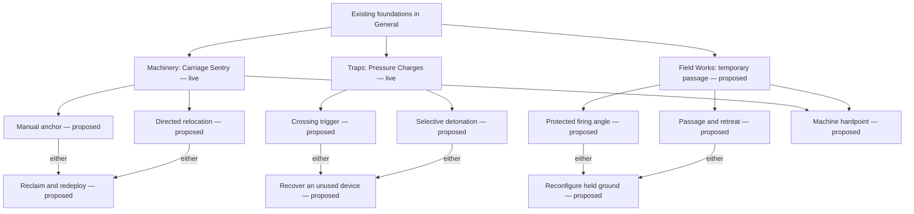

# Skill-tree research and Grave Accord design brief

Researched 2026-11-02 against developer sources and the actual local implementation. Follow [the Free Play polish roadmap](FREE_PLAY_POLISH_ROADMAP.md) for development order. The proposed graph and mechanics below are not implemented content.

Runtime follow-up: [CLASS_TREE_POLISH.md](CLASS_TREE_POLISH.md) implements the first General/Specializations separation and the sentry aiming correction. The following audit describes sourceab8e4b3; the General grid is preserved, while the two live Engineer choices now have their own authored fork. The fuller proposed graph remains unfinished.

## Finding: the audited rigidity is structural

For each of the twelve classes, the existing expanded map has **54 nodes, 45 prerequisite edges and nine disconnected six-node chains**. There are no internal forks, rejoining prerequisites or connections between subbranches. The decorative class/branch lines suggest a hierarchy, but do not introduce further gameplay choices. Engineer's two additional live specialization cards sit outside that old graph and are not included in those counts.

`src/client/ui/skill-map.ts` places nodes at `x = 100 + lane × 200`, `y = 290 + (depth − 1) × 112`. It draws prerequisite edges vertically and navigates keyboard focus by lane/depth. At the audited source, `src/client/ui/shop.ts` appended the Engineer cards below the old tree; General contained only two mobility purchases. `content/skills.json` permits only one prerequisite per legacy node. Merely drawing curved edges would preserve those nine chains and their decisions.

The audit is recorded in `reviews/class-tree-research-2026-11-02/grave-accord-topology.json`, with source-file hashes and per-class counts. This is an audit of data and code, not a rendered or hands-on acceptance result.

## What released games demonstrate

| Developer source | Verified design | Application to Grave Accord — an inference |
| --- | --- | --- |
| [Grinding Gear Games: exported Path of Exile tree data](https://github.com/grindinggear/skilltree-export) | The official export describes groups, orbital positions and node adjacency. The pinned data includes genuine junctions; sample node 265 has three neighbors and node 487 has seven. | Author spatial clusters and actual connections. Avoid manufacturing a huge travel-node web for a short Free Play run. |
| [Crate: Grim Dawn Devotion guide](https://www.grimdawn.com/guide/character/devotion/) | Constellations have entry stars and internal routes. Affinity from completed constellations admits other clusters. Some stars grant powers assigned to eligible skills. Removing a supporting constellation is restricted. | Give pathways recognizable landmarks and meaningful interaction nodes. Keep dependency removal safe if respec is ever added. Do not import another currency or affinity grind. |
| [ArenaNet: Specializations, Part One](https://www.guildwars2.com/en/news/specializations-part-one-a-primer/) | The historical redesign explicitly separates stats from traits and uses one major choice per tier to strengthen build identity. | General/Specializations separation matches the user's request. A tidy layout can work when alternatives matter; irregular geometry is not itself depth. |
| [Last Epoch: Skill Specialization](https://support.lastepoch.com/hc/en-us/articles/46363203944859-Skill-Specialization) | Known skills can receive their own specialization trees. At most five specialized slots match the action bar. Respecialized skills have a minimum level and may catch up faster. | Customize existing ability slots with bounded active complexity. Make replay comparisons affordable to understand. Do not add a separate skill-XP grind to this game's Campaign. |
| [Blizzard: Diablo IV 3.0.0 skill-tree update](https://news.blizzard.com/en-us/article/24267729/prepare-for-the-reckoning-lord-of-hatred-draws-near) | The 2026 redesign removes passive nodes from the skill tree, moves some defining effects into it, and gives active skills progressive modifier branches with a chosen modifier in each. Later variants can change skill categories. | Prioritize changes to how an ability works and the interactions it enables. Keep general stat growth elsewhere. Do not copy the game's point budget or expansion access rules. |

The Guild Wars 2 article is historical design rationale, not a claim about every live 2026 trait. Diablo IV's 2026 update is used rather than an obsolete launch-tree description. Last Epoch's support article was updated February 12, 2026. Grim Dawn's guide and illustration are developer-published references, not a verified current build walkthrough.

The Path of Exile JSON was inspected at revision `8bd138b32ea2631455cac5935bfab089f826094f`, dated July 31, 2026. SHA-256: `7e9f755e33152129ebf36c2ebdad639c527e4ad70d274b1fefb860f30ca01122`. Its 3,390 node records and 797 group records describe that export, including special records; they are not asserted to be the allocatable main-tree count. Provenance and compact examples are retained in `reviews/class-tree-research-2026-11-02/poe-source.json`. No external game data/assets are included in Grave Accord.

The [official Grim Dawn illustration](https://www.grimdawn.com/wp-content/uploads/sites/3/2019/09/devotion_UI01.jpg) was inspected as a local research image. Distinct silhouettes, changing cluster geometry, brighter selected routes and clear gaps make regions recognizable. That visual observation supports cluster landmarks; it does not prove every route is readable at every resolution. No browser automation, game screenshots or hands-on play were used in this research.

## Proposed information architecture

**General:** the current numerical class foundations plus the shared mobility skills. Retain the existing compact/expanded presentations as useful inspection options while moving their placement. Keep prices, prerequisites and effects stable during that move.

**Specializations:** a dedicated, class-specific graph of behavior-changing techniques, with an always-available inspector and a compact accessible list of the same choices. Each class eventually has at least three meaningful pathway regions. A full view shows their relationship; inspecting a region reveals its immediate alternatives and prerequisites. Do not hide new pathways at the bottom of 54 old nodes.

Existing transformations and behavior-bearing capstones require an explicit inventory before presentation changes. Display each owned technique once as a purchase, and reuse its issued ID. If a specialization depends on a General foundation, show a labeled reference/jump to it; the reference is not a duplicate node or a second charge. Any later prerequisite/effect migration is a separate reviewed gameplay change. Old ownership must never become an unearned new ability.

Campaign retains its existing training view during this Free Play work. No SP tree is exposed there. Its future use of the same techniques depends on slow authored learning, proof and preparation in the final Campaign phase.

## Rules for a genuine specialization graph

1. **Early identity.** An affordable entry changes an actual action. Its basic loop works without a distant capstone. Existing Engineer entry prices and IDs remain intact.
2. **Real forks.** A split offers different methods, such as an automatically tracking device versus a committed firing lane. If both could be bought together, say why that is legal and useful; otherwise declare the exclusion before purchase.
3. **Purposeful joins.** A later technique can accept either of two prior methods when both teach the relevant operation. A join must not secretly require both alternatives in an exclusive pair.
4. **Limited bridges.** A hybrid requires compatible behaviors from two regions and sacrifices something valuable. A line is shown only when that relationship is legal in shared authority. Machinery plus Traps is not a legal hybrid under the current Q exclusion.
5. **Distinctive culminations.** Advanced techniques deepen the path's decisions. Keep the one-capstone rule, 27-SP run ceiling and existing grade scale until a separately tested change justifies otherwise. Breadth within a grade need not increase prepared power.
6. **No topology quota.** Do not force loops, symmetrical counts or bridges onto every class. Connections need gameplay meaning. New entries at every one of eighteen grades would recreate filler; offer useful options across bands from D- through SS+ without rapid Campaign promotion.

The allocation dependency graph should remain acyclic. Spatial routes can curve and split/rejoin without cyclic requirements. A true circular connectivity model would need a different allocation rule; do not copy Path of Exile adjacency into an ordered prerequisite system by accident.

## Engineer reference: proposed shape

Machinery and Traps already have live D- entry techniques. **Field Works is the proposed third specialization**, focused on finite terrain and position construction, distinct from Tank escorting and Ranger fieldcraft. Work toward three regions around an existing General-foundation reference. Add a fourth only if a different useful loop emerges.

The following is a schematic of dependencies, not final screen geometry, names, prices, grades or unlocked skills. It illustrates real alternatives and legal joins rather than decorative lines. Only Carriage Sentry and Pressure Charges are live new techniques today.

Constraints: M and T exclude each other; MA/MB, TA/TB and FA/FB are proposed internal choice pairs. Each join labeled “either” means one predecessor is sufficient. H would require **both M and F**, with a further commitment cost. The diagram does not imply all three entry techniques can be owned together. G is a navigation reference to the actual required General node(s), not a new purchasable universal prerequisite.

| Region | Concrete decision to prototype, one at a time | Tradeoff that must be resolved before admission |
| --- | --- | --- |
| Machinery | Choose anchoring for a known lane or deliberately directing the carriage's relocation; later reclaim useful hardware instead of waiting out its life. | Movement loses fire, deployments remain finite and ownership is explicit. Current aim-follow behavior must be audited; aiming alone should not accidentally make the comparison unusable. Recast/input semantics must fit Q rather than add a hidden hotbar. |
| Traps | Choose a visible crossing trigger or selective detonation, then a way to recover an unused commitment. | Arming, visible fuse, finite capacity, cover, ordinary/boss differences and cleanup remain real. A detonation input cannot ambiguously spend a fresh placement cooldown. |
| Field Works | Shape a temporary passage or firing angle with finite deployable geometry, rather than merely gain barrier health. | Whole-body legal placement, no sealed maps or ally prisons, no forbidden shielding, no neutralization of fixed boss threats. This is not yet an implemented E variant. |
| One later bridge | A Machinery + Field Works hardpoint commits the machine to a valid owned position. | It must give up mobility/uptime or another useful option, never grant all paths' best output. It cannot require or grant the mutually exclusive Traps node. |

These proposals deliberately leave tuning and some input details open. Resolve them in the current pathway's slice, before implementing another pathway. Do not turn the table into a batch of untested new mechanics.

## Implementation contract

Keep the legacy single-prerequisite data stable. For new graph rules, introduce an explicit shared requirements model capable of **all required**, **one of these required** and **excluded together**, with class and mode admission. The shop, inspector, purchase command, restore validator and eventual Campaign preparation must agree. Graph edge groups carry the same rule; visual connections are derived from authority rather than maintained independently.

New IDs need a collision audit across legacy, General and specialization collections. Preserve issued `engineer-machinery-1` and `engineer-traps-1`; a naïve `${classId}-${path}-1` generator collides with existing foundations such as `soldier-command-1`. Archived saves cannot invent future nodes. Update content/protocol migrations deliberately when actual runtime contracts change; a documentation roadmap changes neither.

Validate missing references, cycles, contradictory requirements and impossible exclusive joins. Test affordability of representative routes with the real 3-SP start and 27-SP ceiling. Do not advertise a legal-looking bridge that cannot be reached within the actual rules. Any future refund must validate the resulting owned set and dependent skills; respec is not currently promised by this design.

## Presentation and navigation

Use the game's parchment/material vocabulary with three clear regions and generous separation. Large distinctive nodes identify actions or major transformations; quieter shapes identify supporting techniques. Color supports labeled states rather than carrying meaning alone. Highlight the selected node's required route, eligible alternatives and conflicts; unrelated lines stay quiet. Text states explain owned, available, unaffordable, missing prerequisite and incompatible choices.

Give each node a concise verb-led description, affected slot, actual cost, grade, prerequisites and the behavior it replaces. Show known limitations before purchase. Inspect and buy remain separate actions. Keep the inspector visible while panning; preserve the selected node and focus when buying or changing views. Do not cover the playfield with the tree during combat.

The graph needs authored coordinates and graph/spatial keyboard navigation; `lane ± 1` and `depth ± 1` will no longer suffice. Tab must leave the tree normally. Directional focus should choose a predictable visible neighbor, not jump to a distant node in an invisible column. Offer an equivalent linear inspection view at narrow widths and for assistive technology. Panning/zoom are secondary controls, with reset/fit and preserved reading position; they cannot compensate for overlapping labels or tiny targets. Reduced motion remains meaningful.

## Verification and the next concrete slice

Research and the roadmap are the first completed planning unit. The first runtime slice now implements **General/Specializations separation with an honest Engineer graph**, preserving the two existing live purchases; see CLASS_TREE_POLISH.md. The next functional work remains Engineer, one pathway at a time. It must not label proposed branches selectable or draw fictional prerequisite edges. Functional forks and Field Works follow in individual tested slices; the graph grows as those mechanics become real.

Use native DOM fixtures for tab placement, details, keyboard focus and same-choice compact/expanded views; shared-authority tests for costs/conflicts/restore; simulation/network fixtures for actual techniques. Then run the appropriate full gate and exact-source CI, and freeze matching review builds. Browser automation remains disabled. Human enjoyment, rendered readability, touch/device, listening, localization, motion and final balance are separate acceptance categories. No test count is a substitute for them.
